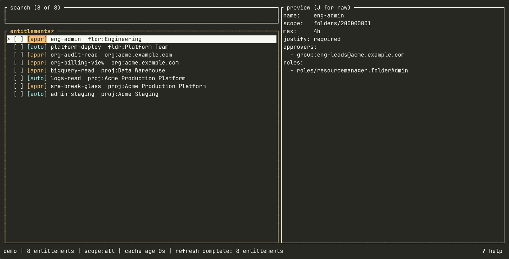
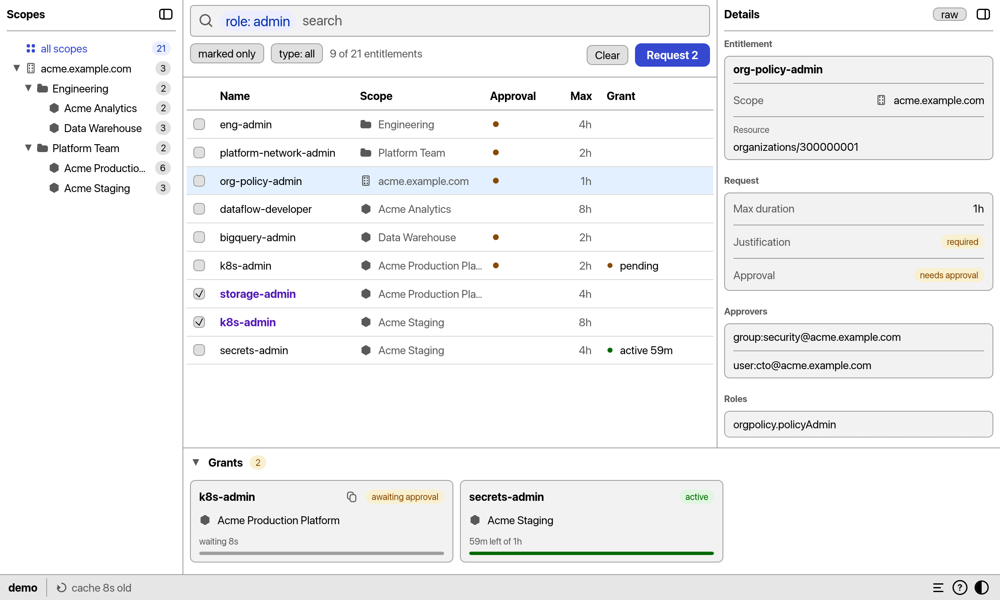

# gpam

[](https://github.com/michalskalski/gpam/actions/workflows/ci.yml)
[](https://crates.io/crates/gpam)
[](https://crates.io/crates/gpam-gui)

A keyboard-driven client for [Google Cloud Privileged Access Manager](https://docs.cloud.google.com/iam/docs/pam-overview). Browse the entitlements you can request, submit grants with a duration and justification, and watch them become active.

It comes as two frontends that share one backend and one cache.

| Crate | What it is | Published |
|---|---|---|
| [`gpam`](crates/gpam) | The terminal UI | [crates.io](https://crates.io/crates/gpam) |
| [`gpam-gui`](crates/gpam-gui) | The desktop GUI | [crates.io](https://crates.io/crates/gpam-gui) |
| [`gpam-core`](crates/gpam-core) | The shared backend, cache and view state behind both | [crates.io](https://crates.io/crates/gpam-core) |

## Terminal UI: `gpam`



```
brew install michalskalski/gpam/gpam
cargo install gpam
```

Pre-built binaries for Linux and macOS are on the [GitHub releases page](https://github.com/michalskalski/gpam/releases). See the [gpam README](crates/gpam/README.md) for its options and subcommands.

## Desktop GUI: `gpam-gui`



```
cargo install gpam-gui
```

Keyboard driven like the terminal UI, with the usual mouse support. The currently supported platforms are macOS and Linux. See the [gpam-gui README](crates/gpam-gui/README.md).

## Quick start

Try either frontend without a Google Cloud account, on built-in sample data:

```
gpam --demo
gpam-gui --demo
```

For real use, Application Default Credentials must be available:

```
gcloud auth application-default login
```

Both frontends take `--no-projects`, `--no-folders` and `--no-orgs` to skip a tier of entitlement discovery.

## Access model

1. The Cloud Resource Manager API (`cloudresourcemanager.googleapis.com`) must be enabled in your ADC quota project, which is what backs the project/folder/org enumeration. Set it with `gcloud auth application-default set-quota-project <PROJECT>`.
2. Resource visibility (IAM-side): gpam enumerates the projects, folders, and organizations you can see and searches each for entitlements. That enumeration uses `resourcemanager.projects.get`, `resourcemanager.folders.get`, and `resourcemanager.organizations.get`. The standard way to grant these at the right scope is the Browser role (`roles/browser`). You can skip a scope tier with `--no-projects`, `--no-folders`, or `--no-orgs` if you don't have visibility there. Polling grant state uses `privilegedaccessmanager.grants.get` provided by `roles/privilegedaccessmanager.viewer`.
3. Eligibility (PAM-side): to see and request an entitlement, you must be listed as a requester on it (directly or via a group).

## Approving grants

PAM's `SearchGrants` API requires a `parent` entitlement, so finding the grants a user can approve means fanning out one call per entitlement on every poll. That makes per-user discovery impractical past a few dozen entitlements.

gpam therefore doesn't try to discover approvals on its own. Event delivery sits outside the tool. Any producer that writes a line to the local socket (a Pub/Sub bridge, webhook receiver, email-link handler, etc.) acts as the source. Once an event lands, gpam queues it and presents it for review.

A running frontend binds `~/Library/Caches/gpam/gpam.sock` (macOS) / `~/.cache/gpam/gpam.sock` (Linux), and accepts JSON Lines:

```
{"name":"organizations/000/locations/global/entitlements/foo/grants/<uuid>","source":"source-name"}
```

`name` is required and must be a fully-qualified grant resource name (`organizations|folders|projects/<id>/locations/<loc>/entitlements/<ent>/grants/<id>`). `source` is optional metadata.

The `gpam` binary has two subcommands for producers, `gpam send` and `gpam approve`. They are described in the [gpam README](crates/gpam/README.md#subcommands-for-approval-producers).

## Cache

Per-account SQLite at `~/Library/Caches/gpam/<account>.db` (macOS) or `~/.cache/gpam/<account>.db` (Linux). Soft freshness 30 m (background refresh), hard 24 h (block on refresh). Both frontends use the same cache.

## License

Licensed under either of [MIT](LICENSE-MIT) or [Apache-2.0](LICENSE-APACHE) at your option.
