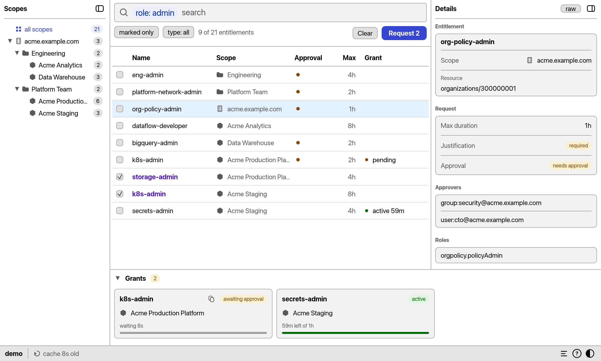

# gpam-gui

Desktop UI for [Google Cloud Privileged Access Manager](https://docs.cloud.google.com/iam/docs/pam-overview). Browse the entitlements you can request, submit grants with a duration and justification, and watch them become active.



It is keyboard driven, with the usual mouse support. The currently supported platforms are macOS and Linux.

## Install

```
cargo install gpam-gui
```

Building needs no extra system packages. At runtime Linux needs OpenGL (EGL or GLX), libxkbcommon and fontconfig, which desktop installations already have.

## Run

Try it without a Google Cloud account, on built-in sample data:

```
gpam-gui --demo
```

For real use, Application Default Credentials must be available:

```
gcloud auth application-default login
gpam-gui
```

Press `?` in the app for the key bindings.

## More

`gpam-gui` shares its backend, cache and behaviour with the terminal UI, [`gpam`](https://crates.io/crates/gpam). The [project README](https://github.com/michalskalski/gpam#readme) describes the access model, grant approval and the cache.

## License

Licensed under either of [MIT](https://github.com/michalskalski/gpam/blob/main/LICENSE-MIT) or [Apache-2.0](https://github.com/michalskalski/gpam/blob/main/LICENSE-APACHE) at your option.
