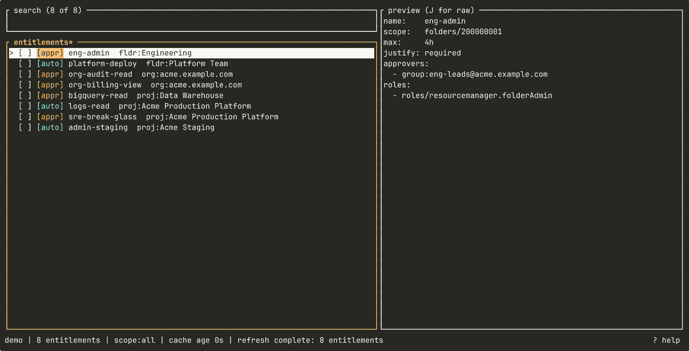

# gpam

[](https://crates.io/crates/gpam)

Terminal UI for [Google Cloud Privileged Access Manager](https://docs.cloud.google.com/iam/docs/pam-overview). Browse the entitlements you can request, submit grants with duration + justification, and watch them transition to Active.



## Install

Homebrew (macOS and Linux):

```
brew install michalskalski/gpam/gpam
```

From crates.io:

```
cargo install gpam
```

Pre-built binaries for Linux and macOS are available on the
[GitHub releases page](https://github.com/michalskalski/gpam/releases).

## Usage

Application Default Credentials must be available for non-demo runs:

```
gcloud auth application-default login
```

```
Usage: gpam [OPTIONS] [COMMAND]

Commands:
  send     Forward a pending grant to a running gpam TUI via its local socket
  approve  Open a one-shot approve modal in this terminal for a known grant

Options:
      --demo         Run with seeded fixtures instead of talking to GCP
      --no-projects  Skip project-scope entitlement discovery
      --no-folders   Skip folder-scope entitlement discovery
      --no-orgs      Skip organization-scope entitlement discovery
  -h, --help         Print help
  -V, --version      Print version
```

Press `?` in the app for the key bindings.

## Subcommands for approval producers

gpam does not discover the grants you can approve on its own. A producer outside the tool forwards them, and these two subcommands are how it does that:

```
gpam send <name> [--source <tag>]   # forward into the running TUI (non-zero if no listener)
gpam approve <name>                 # one-shot modal in this terminal — no socket
```

Together they can compose a clean fallback: `gpam send "$NAME" || gpam approve "$NAME"`.

`<name>` is a fully-qualified grant resource name. The [project README](https://github.com/michalskalski/gpam#approving-grants) explains the approval flow and the socket format.

## More

The [project README](https://github.com/michalskalski/gpam#readme) describes the access model, grant approval and the cache. There is also a desktop frontend, [`gpam-gui`](https://crates.io/crates/gpam-gui).

## License

Licensed under either of [MIT](https://github.com/michalskalski/gpam/blob/main/LICENSE-MIT) or [Apache-2.0](https://github.com/michalskalski/gpam/blob/main/LICENSE-APACHE) at your option.
